# Comet-Image

*Part of the [Comet hub](../README.md).*

| Model | Status |
|---|---|
| **Comet-Image-v4.1-Flash** | **GA.** Latent DiT, 256×256, 30 steps, 2 h of training, public data only |
| **Comet-Image-v4.1-Flash-Lite** | **GA.** v4.1-Flash distilled to **8 steps** |
| **Comet-Image-v4.2-Flash-Preview-2026-11-10-1855** | **Latest preview.** 1823 + 30 min more on the same data (60 min on the big mix) |
| Comet-Image-v4.2-Flash-Preview-2026-11-10-1823 | Preview. 2134 + 30 min on **51,827 PD12M photos** + the old data (108,905 latents) |
| Comet-Image-v4.2-Flash-Preview-2026-11-09-2134 | Preview. 2032 + 15 min on more varied data (+1,700 PD12M CC0 photos) |
| Comet-Image-v4.2-Flash-Preview-2026-11-09-2032 | Preview. v4.1-Flash + 60 min (3 h total), 30 steps |
| Comet-Image-v4-Flash-Preview-2026-11-09-1641 | Preview checkpoint (60 min), superseded by v4.1 |
| Comet-Image-v4-Flash-Distill-Preview-2026-11-09-1711 | Preview 8-step distillation of 1641, superseded by v4.1-Flash-Lite |
| Comet-Image-v4-Flash-Preview-2026-11-09-1604 | Earlier checkpoint (30 min of training) |
| Comet-Image-v4-Flash-Preview-2026-11-08 | First pass (15 min of training) |
| Comet-Image-Preview-v3-2026-11-08 | 🗄️ **Legacy, discontinued** (2026-11-08) |
| Comet-Image-Preview-v2-2026-11-08 | 🗄️ **Legacy, discontinued** (2026-11-08) |
| Comet-Image-Preview-2026-11-08 (v1) | 🗄️ **Legacy, discontinued** (2026-11-08) |

*v1, v2 and v3 were trained only on Talmeez's screenshots and are discontinued. Their write-ups stay below as a record. Current: **Comet-Image-v4.1-Flash** and **v4.1-Flash-Lite** (GA), efficient, fast-training and fast-generating model trained only on public images. "Preview" means the first training pass is released, then the model keeps training until it's right.*

## Comet-Image-v4.2-Flash-Preview-2026-11-10-1855: 60 minutes on the big mix

Continued 1823 for **30 more minutes** on the same 108,905 latents (same recipe), for 60 minutes in total on the big PD12M mix.

- Eval loss on the new mix: 0.7224 → 0.7231 (10 min, the usual bump when the learning rate restarts at full) → 0.7223 (20 min) → **0.7212**. Over the full 60 minutes: **0.7278 → 0.7212**.
- Images: very close to 1823, a little cleaner (e.g. the coastline's sky and treeline). Most of the visual gain came from the new data in the first 30 minutes; the second 30 minutes mostly polished it.
- Copy check: median distance to the nearest training image 48.7 (minimum 40.5) vs 52.9 between different training images. New images, not copies.

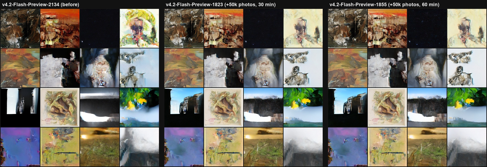

Weights: [GitHub Release](https://github.com/TerminalDev-1/Comet/releases/tag/comet-image-v4.2-flash-preview-2026-11-10-1855).

**Next:** progress per 30 minutes is shrinking again, so the next step is more new photos (another PD12M shard) rather than more time on these. An 8-step Lite can be distilled from 1855.

## Comet-Image-v4.2-Flash-Preview-2026-11-10-1823: 50,000 new photos

The big data run. Downloaded **50,127 more public-domain/CC0 photos** from [PD12M](https://huggingface.co/datasets/Spawning/PD12M) (`fetch_pd12m.py --shard 1 --n 50000 --workers 128`, ~2,300 images/min, 23 minutes), giving **51,827 PD12M photos** in total, about 5× more distinct images than everything used before. Each photo became one center-crop latent (`encode_latents.py --crops 0`, ~4,000 images/min with the new threaded loader; extra crops are near-duplicates and tripled the encode time), merged with the old 57,078 latents: **108,905** total (`latents256_big.npy`, 850 MB, fits on the GPU next to training).

Trained 2134 on the mix for **30 minutes** (10,397 steps, ~6 passes over the data), same recipe (`--lr 2e-4 --warmup 100 --t_shift 0.5`, 32.6M, checkpoints every 5 min).

- Eval loss on the new mix: **0.7278 → 0.7254 (10 min) → 0.7238 (20 min) → 0.7224**. That's a steady drop, about 1.5× the rate seen on the old data. These numbers use the new mix, so they aren't comparable with the old-data evals (e.g. 2032's 0.6574) or the Frontier Comet chart.
- Images: same seeds as 2134, clearly more photographic. Blue skies, horizons, mountains behind a coast, and a field under a sky appear where 2134 had abstract shapes. Still rough overall.
- Copy check: generated images sit a median 49.1 from their nearest training image (minimum 39.2), vs 52.9 between different training images (minimum 16.6). New images, not copies.

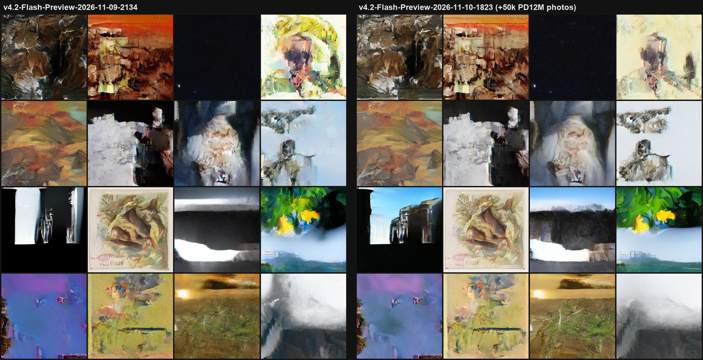

Weights: [GitHub Release](https://github.com/TerminalDev-1/Comet/releases/tag/comet-image-v4.2-flash-preview-2026-11-10-1823).

## Comet-Image-v4.2-Flash-Preview-2026-11-09-2134: more varied data

Started on more data instead of more hours: **1,700 public-domain/CC0 photos** from [PD12M](https://huggingface.co/datasets/Spawning/PD12M) (`fetch_pd12m.py`, everyday subjects), encoded into 10,200 latents and merged with the old 57,078 (**67,278** total, `latents256_plus.npy`). Trained 2032 on the mix for 5 + 10 minutes. Eval on the new mix: 0.678 → 0.6781 (flat; 15 minutes is too short to learn the new photos, and these numbers aren't comparable with the old-data evals). Images: a bit more texture in rocks, foliage and grass.

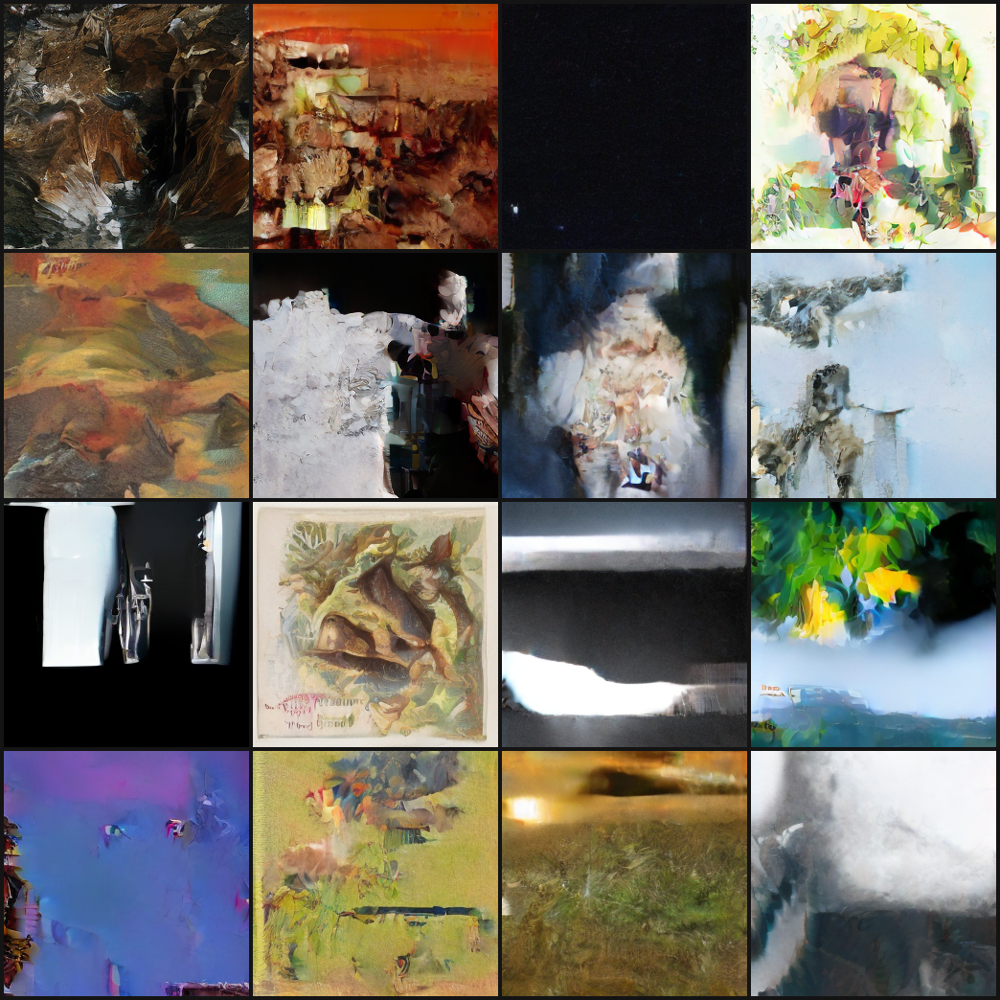

Also tried and **dropped**: growing v4.2 to 64.5M parameters (24 blocks, `--grow_layers`) for 20 minutes. Eval 0.6589 vs 0.6574 for the 32.6M model, same-looking images, twice the cost.

**Next:** many more new photos (PD12M has 12 million; the download ran at ~500 images/min) and a longer run on them.

Weights: [GitHub Release](https://github.com/TerminalDev-1/Comet/releases/tag/comet-image-v4.2-flash-preview-2026-11-09-2134).

## Comet-Image-v4.2-Flash-Preview-2026-11-09-2032

Continued from **v4.1-Flash** for **60 more minutes** (3 h in total), same recipe, checkpoints every 5 min. Eval loss **0.6644 → 0.6574** (0.6651 at minute 10, as the restart at full learning rate briefly undoes v4.1's cooldown, then steadily down).

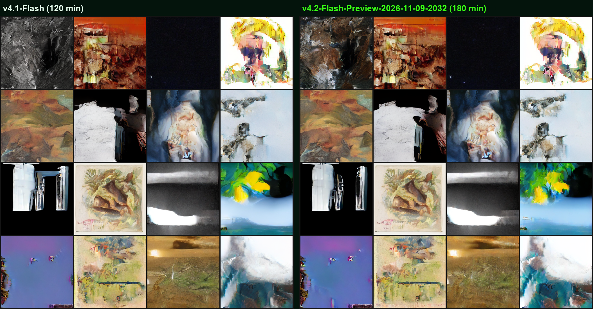

*Same seeds. v4.2 is very close to v4.1: a little more texture and color (top-left), slightly crisper edges, still mostly abstract. Copy check: median distance to the nearest training image 49.0 vs 49.7 between different training images (new images, not copies).*

**Takeaway:** more training on the same 9,514 images now gives small gains (eval −0.007 per hour). Clearly better images need more and more varied training data, or a bigger model.

Weights: [GitHub Release](https://github.com/TerminalDev-1/Comet/releases/tag/comet-image-v4.2-flash-preview-2026-11-09-2032).

## Comet-Image-v4.1-Flash and v4.1-Flash-Lite (GA)

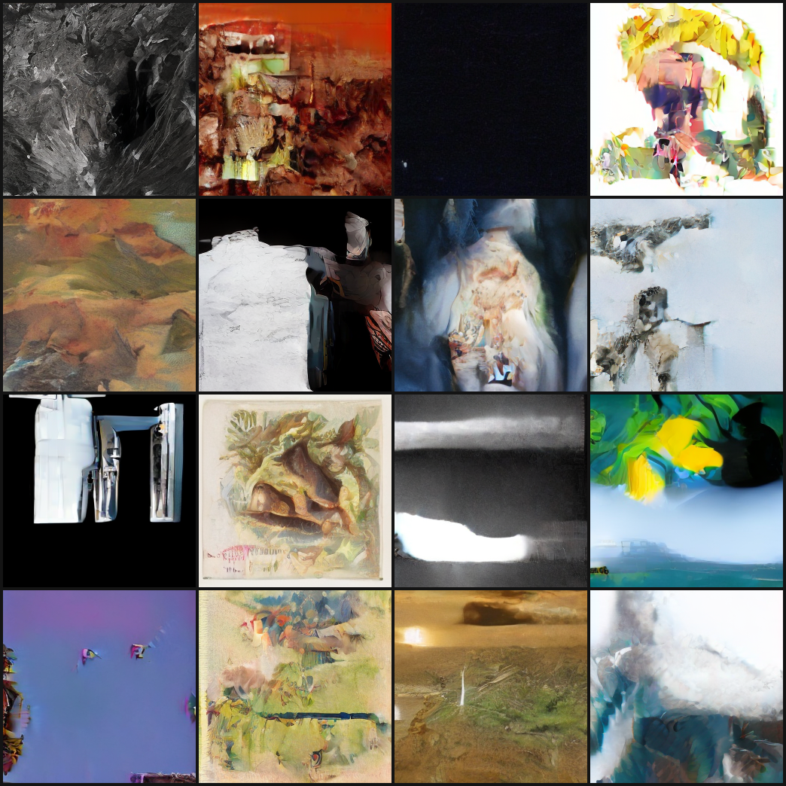

*16 images from **Comet-Image-v4.1-Flash**, 256×256, 30 steps.*

**v4.1-Flash** continues the v4-Flash-Preview line (1641 checkpoint) for **60 more minutes**: 2 hours of training in total. Same architecture and data, lr 2e-4, `--t_shift 0.5`. The run was hit by a power cut at minute 26 and resumed from its minute-20 checkpoint, so it is 20 + 40 minutes. Checkpoints now save every 5 minutes.

| Checkpoint | Training | Eval loss |
|---|---|---|
| Comet-Image-v4-Flash-2026-11-08 | 15 min | 0.7182 |
| v4-Flash-Preview-2026-11-09-1604 | 30 min | 0.6982 |
| v4-Flash-Preview-2026-11-09-1641 | 60 min | 0.6787 |
| **Comet-Image-v4.1-Flash** | **120 min** | **0.6644** |

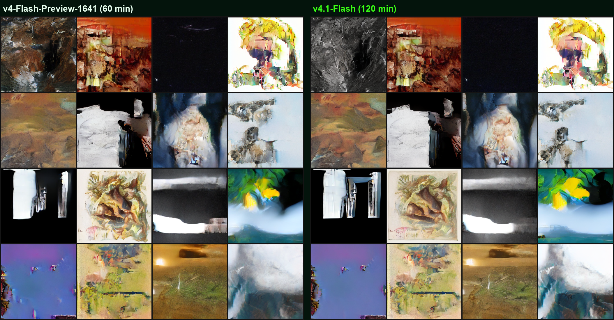

*Same seeds. v4.1 has more structure: sharper rock textures, cleaner objects on black, richer colors, and an illustration-card-like image with an animal shape and handwriting-like marks. Most images are still abstract, not clear objects.*

**Copy check** (`copy_check_latent.py`): generated images are as far from their nearest training image (median latent distance 47.8) as different training images are from each other (49.7). Top row generated, bottom row nearest training image (a comet, Venus, Saturn's rings, a rocket launch...): they're new images.

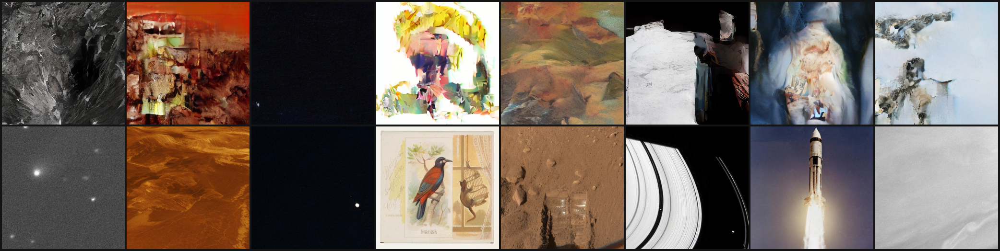

**v4.1-Flash-Lite** is v4.1-Flash distilled to 8 steps (`distill_flash.py`, 15 min): the 8-vs-30-step gap goes **0.0794 → 0.0057**.

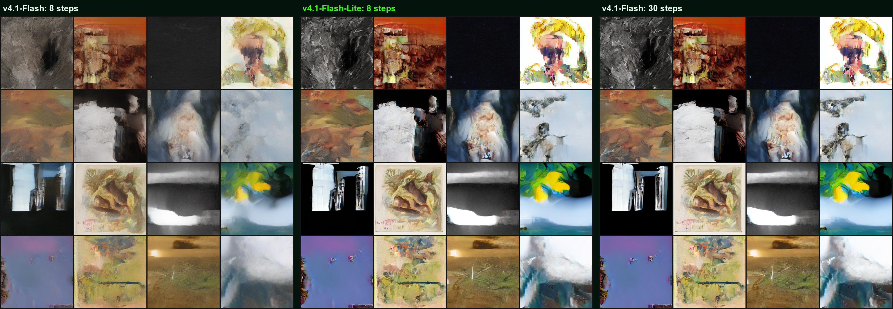

Weights: [Comet-Image-v4.1-Flash](https://github.com/TerminalDev-1/Comet/releases/tag/comet-image-v4.1-flash) (30 steps) · [Comet-Image-v4.1-Flash-Lite](https://github.com/TerminalDev-1/Comet/releases/tag/comet-image-v4.1-flash-lite) (8 steps).

```bash
python generate_flash.py Comet-Image-v4.1-Flash.safetensors --out images --n 4          # 30 steps
python generate_flash.py Comet-Image-v4.1-Flash-Lite.safetensors --out images --n 4     # 8 steps
```

## Comet-Image-v4-Flash-Preview-2026-11-08 (preview history)

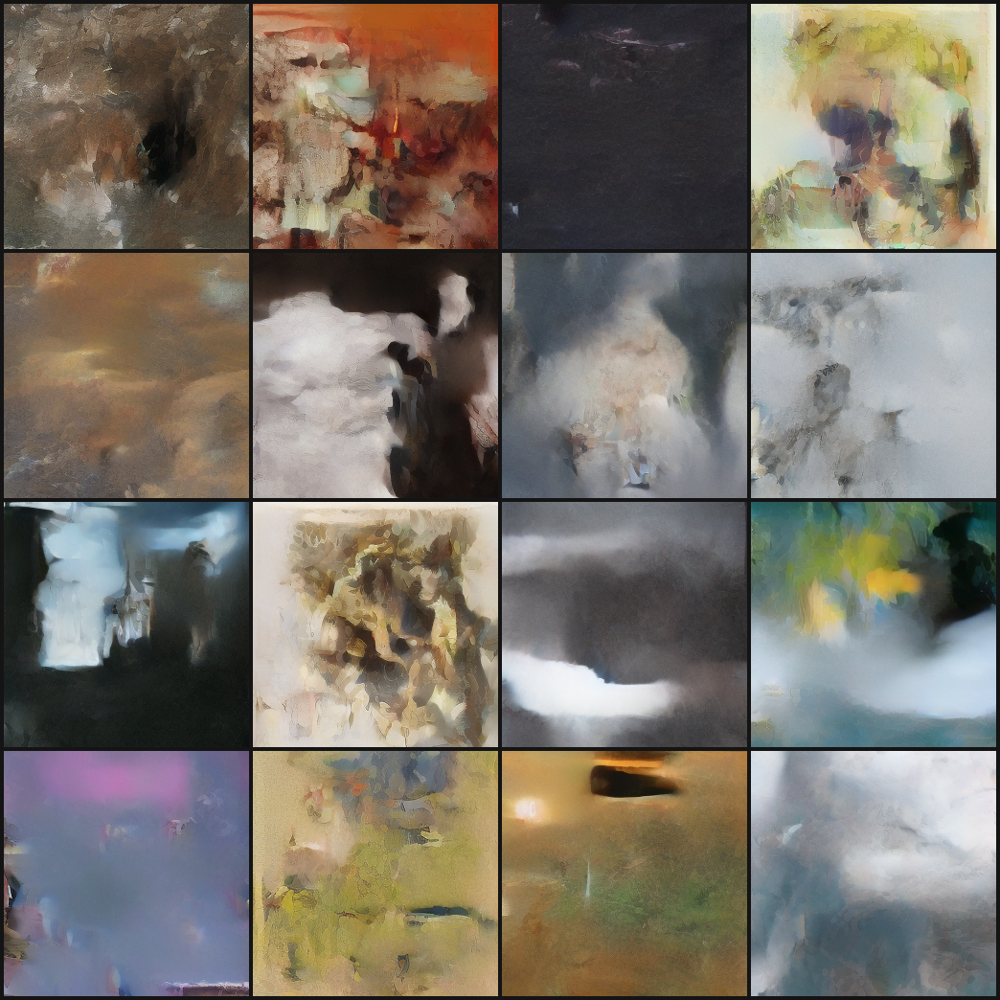

*16 images from **Comet-Image-v4-Flash**, 256×256, generated in **8 steps** (3.3 seconds for all 16, ~0.2 s per image including decoding).*

**What makes it efficient: latent diffusion.** Instead of working on pixels, v4-Flash works on the compressed "latents" of Stable Diffusion's image compressor (VAE, `stabilityai/sd-vae-ft-mse`, MIT). A 256×256 image becomes a 4×32×32 latent: **256 tokens** with patch 2, versus 1,024 tokens for a 128×128 image in pixel space. The VAE decoder turns generated latents back into full-resolution images and supplies the fine detail.

| | |
|---|---|
| Model | Latent DiT, **32.6M params** (d=384, 12 layers, 6 heads, patch 2, in_ch=4) |
| Data | **57,078 latents** from **9,514 public images**: 6,167 NASA space images (CLIP-filtered from 8,619; `fetch_nasa.py`, `filter_space.py`) + 3,347 CC0 Microcosmos images (`fetch_microcosmos.py`). Encoded with `encode_latents.py` (one centered view + 5 crops each, 256×256) |
| Training | 15 min on the RTX 4060 Ti, batch 64, AdamW 3e-4, flow matching, EMA 0.999. **371 images/sec** (8× faster than the 73.6M pixel-space attempt, at 4× the pixels). 5,219 steps, 4.9 GB VRAM. Loss 1.27 → **0.73** (latent losses run higher than pixel losses) |
| Generation | **8 Euler steps** (Flash). 30 steps are also available for sharper images |

**What it makes:** soft, painterly 256×256 scenes, like impressionist paintings: cloudy skies and cloud banks, misty landscapes with trees, golden fields, rocky textures, warm oranges and dark night tones. The space data shows mostly as skies, clouds and glowing shapes; distinct suns, moons and planets need more training.

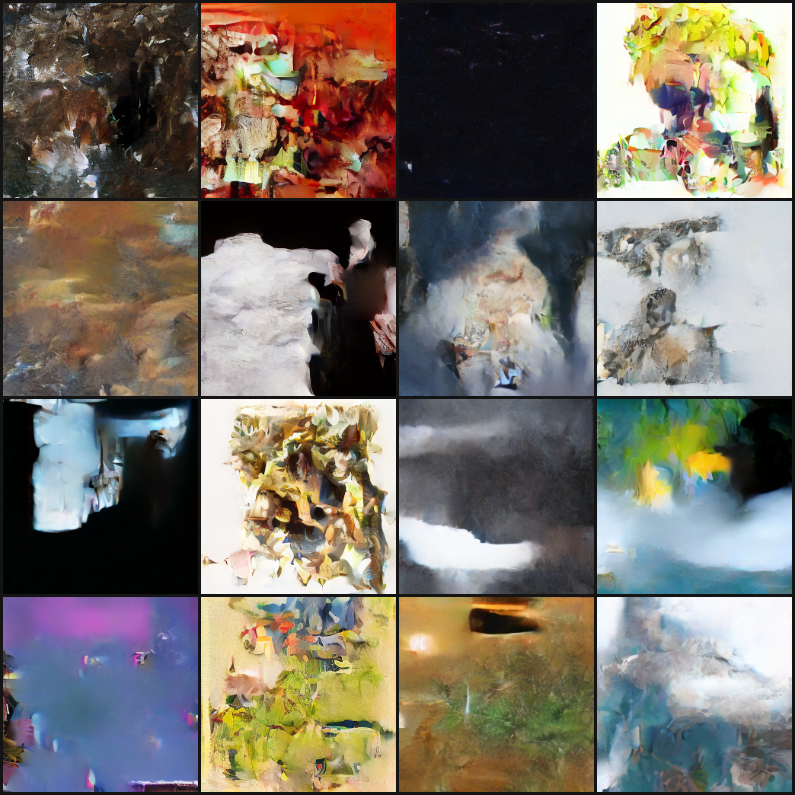

*The same 16 seeds with 30 steps: crisper and more saturated. Flash's 8 steps trade some sharpness for speed.*

Progress: [after 5 minutes](results/comet_image_v4_flash_5min.png) it already made smooth painterly images, where the pixel-space attempt was still colored static at 10 minutes.

**Download the weights:** latest: [Comet-Image-v4-Flash-Preview-2026-11-09-1641](https://github.com/TerminalDev-1/Comet/releases/tag/comet-image-v4-flash-preview-2026-11-09-1641) (60 min of training); [2026-11-09-1604](https://github.com/TerminalDev-1/Comet/releases/tag/comet-image-v4-flash-preview-2026-11-09-1604) (30 min); first pass: [Comet-Image-v4-Flash-2026-11-08](https://github.com/TerminalDev-1/Comet/releases/tag/comet-image-v4-flash-2026-11-08) (15 min). Each is 62 MB fp16 `.safetensors` + config. Generate images:

```bash
python generate_flash.py Comet-Image-v4-Flash-Preview-2026-11-09-1641.safetensors --out images --n 4 --seed 7          # 30 steps (default, sharp)
python generate_flash.py Comet-Image-v4-Flash-Preview-2026-11-09-1641.safetensors --out images --n 4 --steps 8         # faster, softer
```

Scripts: `encode_latents.py` → `train_latent.py` (checkpoint every 5 min; a `STOP` file in the run folder ends training cleanly) → `generate_flash.py` (generate, or `--export` a checkpoint to fp16 safetensors).

### Continued training: 15 more minutes → Comet-Image-v4-Flash-Preview-2026-11-09-1604

As a Preview model, v4-Flash keeps training. Run `Comet-Image-v4-Flash-Preview-2026-11-09` continued from the 15-minute weights (`train_latent.py --init`), same data, lr 2e-4 with a 100-step warmup and the usual cooldown, 15 min, 5,225 steps at 371 images/sec.

Loss **0.730 → 0.709** (last-minute averages). Gains are steady but small: same seeds come out slightly crisper (sharper edges in the doorway, forest and lit-room scenes), with the same painterly style.

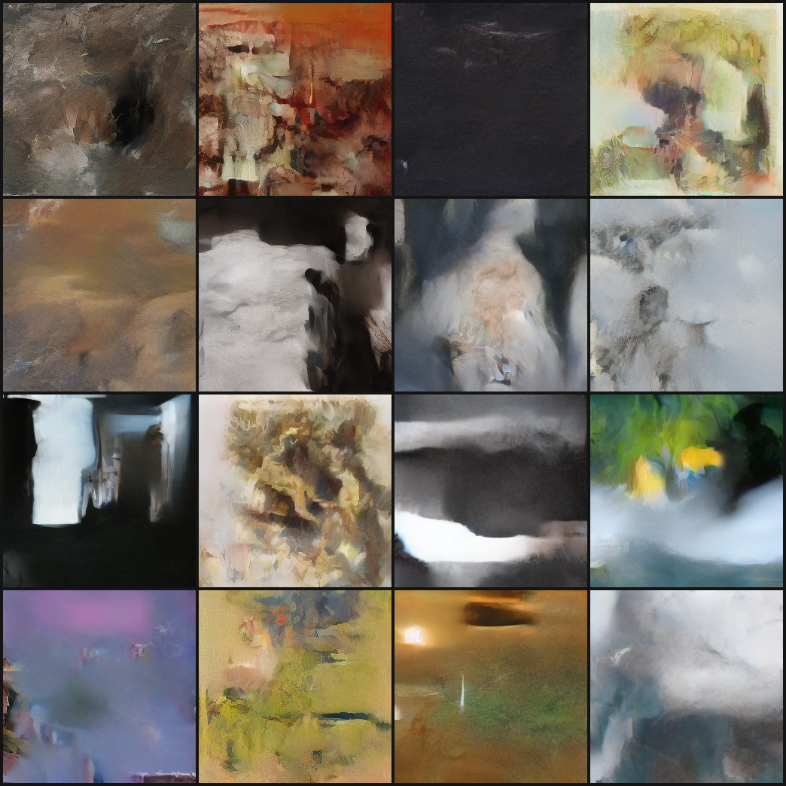

*Same 16 seeds as above, after 30 minutes of training in total, 8 steps. [30-step version](results/comet_image_v4_flash_preview_30min_30steps.png). Released as [Comet-Image-v4-Flash-Preview-2026-11-09-1604](https://github.com/TerminalDev-1/Comet/releases/tag/comet-image-v4-flash-preview-2026-11-09-1604).*

### Sharper: 30 more minutes → Comet-Image-v4-Flash-Preview-2026-11-09-1641

Goal: less blurry, more visible shapes. Continued from 2026-11-09-1604 for **30 minutes** (60 min total, 10,457 more steps), lr 2e-4 with cooldown, plus one recipe change: **`--t_shift 0.5`**, which spends more training on nearly-clean images, where fine detail is learned. Same architecture, same data.

Because `t_shift` changes the training loss itself, runs are now compared on a **fixed eval loss** (1,024 latents, fixed noise and times, EMA weights):

| Checkpoint | Training | Eval loss |
|---|---|---|
| Comet-Image-v4-Flash-2026-11-08 | 15 min | 0.7182 |
| Comet-Image-v4-Flash-Preview-2026-11-09-1604 | 30 min | 0.6982 |
| **Comet-Image-v4-Flash-Preview-2026-11-09-1641** | **60 min** | **0.6787** |

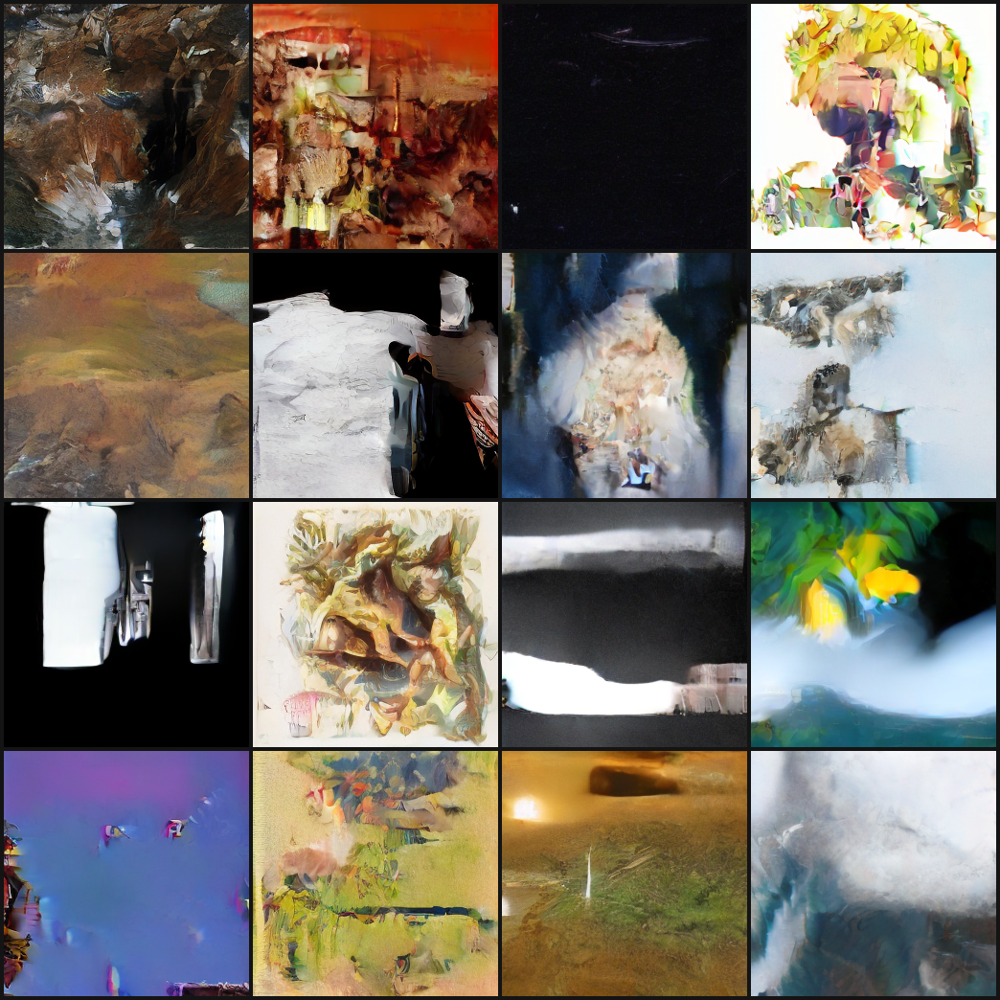

*Same 16 seeds, 60 minutes of training, **30 steps**.*

- ✅ **At 30 steps it's clearly sharper:** harder edges, more contrast, solid shapes (white figures against black, a doorway, rocky textures, a yellow flower against leaves) instead of soft smears.
- ⚠️ **At 8 steps (Flash) it's still soft** ([8-step grid](results/comet_image_v4_flash_preview_60min_8steps.png)): the detail lives in the last sampling steps, which 8 big steps skip.
- ⚠️ **Still not recognizable objects.** 32.6M parameters, 9.5k images and one hour of training make convincing textures and compositions, not clear things.

### Distilled to 8 steps → Comet-Image-v4-Flash-Distill-Preview-2026-11-09-1711

Goal: 30-step sharpness at 8 steps. `distill_flash.py` copies the 1641 model into a student (same architecture) and trains it for **15 minutes** to cover each 4-step stretch of the teacher (32 small steps ≈ 30-step quality) in one big step, so 8 student steps land where 32 teacher steps would. 2,312 steps, batch 64, lr 1e-4, 164 images/sec.

Measure: from 128 fixed noise seeds, the gap (MSE between latents) between 8-step and 30-step results.

| | Gap to 30-step images |
|---|---|
| 1641 model at 8 steps (before) | 0.0712 |
| after 5 min of distillation | 0.0248 |
| after 10 min | 0.0079 |
| **Distilled, 15 min** | **0.0031** (23× closer) |

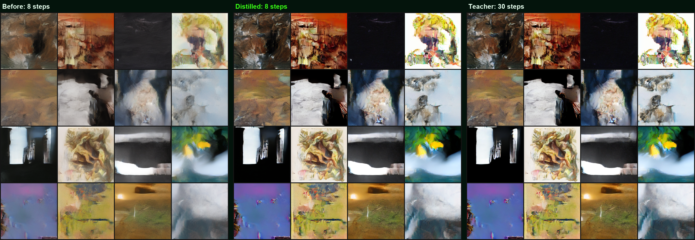

*Same 16 seeds. Left: the 1641 model at 8 steps (soft). Middle: **distilled, 8 steps**. Right: the 1641 model at 30 steps. Middle and right are nearly identical: hard edges, contrast and the bright sun all survive, at ~4× fewer steps.*

Use: `python generate_flash.py Comet-Image-v4-Flash-Distill-Preview-2026-11-09-1711.safetensors --out images --n 4` (its config sets 8 steps). Weights: [GitHub Release](https://github.com/TerminalDev-1/Comet/releases/tag/comet-image-v4-flash-distill-preview-2026-11-09-1711).

## Legacy: Comet-Image-Preview v1, v2 and v3 (discontinued)

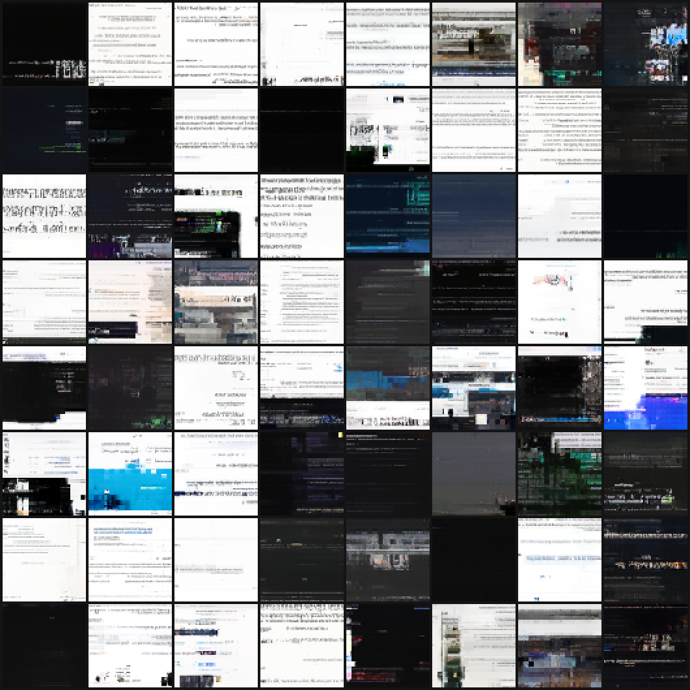

*Legacy: 64 images from **Comet-Image-Preview-v2-2026-11-08** (shown at 2× size). None of them is a real screenshot.*

The first **image model** in the Comet family: a small **Diffusion Transformer (DiT)** trained with flow matching (the Stable Diffusion 3 recipe) on Talmeez's own screenshots, on the RTX 4060 Ti over SSH.

*The screenshots, the training crops, the copy-check images and the weights are private: they stay out of this repo (in `Comet-Image/private/` locally, `~/comet_private` on the PC).*

### Setup (v1)

| | |
|---|---|
| Data | 2,647 screenshots (laptop + PC) → **87,186 random square crops** at 64×64 (`prep_images.py`), mirrored at random during training |
| Model | DiT, 22.0M params: 4×4 patches (256 tokens), d=384, 8 layers, 6 heads, adaLN-Zero time conditioning (`dit.py`) |
| Training | 20 min, batch 128, AdamW 3e-4 with warmup and cooldown, bf16, EMA 0.999. 5,532 steps, ~590 images/sec, 6.4 GB VRAM (`train_image.py`) |
| Sampling | 60 Euler steps from pure noise |
| Loss | 0.90 (min 1) → 0.11 (min 2) → 0.061 (min 10) → **0.053** (min 20) |

### What v1 makes

Small images that clearly *look like screenshots*, without being any particular one:
- **Document and web pages:** white backgrounds, a bolder heading line, rows of tiny "text" (fake squiggles, not readable), paragraph gaps, the odd blue link.
- **Dark-mode windows:** black or charcoal backgrounds with faint text rows and small colored accents (green, orange, blue).
- **App layouts:** horizontal bands, like a toolbar, then content, then a bottom bar; blue desktop-like backgrounds.
- **Weak spots:** busy or photo-like crops come out as blocky mosaics (the 4×4 patch grid shows). No readable text, which is expected at 64×64 and 20 minutes.

Progress across grids (min 4 → 8 → 12 → 16 → 20): static with the right colors → text rows and regions → headings and paragraphs → app-window bands → sharper, with smoother flat areas.

### Copy check (v1)

For 16 samples, the nearest of all 87k training crops (pixel distance) was found and compared side by side. The nearest real crops have readable UI text and sharp edges; the generated ones don't match any of them. Very small distances (10–12) only happen for near-blank tiles (all dark or all white). **The model makes new screenshot-like images; it isn't copying training images.**

### v2: 20 more minutes (Comet-Image-Preview-v2-2026-11-08, legacy)

Continued from v1's weights for another 20 minutes (lr 2e-4), with 8 new screenshots added (87,450 crops). Loss **0.053 → 0.046**. Compared with v1: crisper text pages (evenly spaced lines, indents, bold headings, blue link lines), smoother gradients (blue and gray backgrounds no longer blocky), and fewer chaotic mosaics. Busy photo-like crops are still the weak spot.

**Copy check (v2):** the closest matches (pixel distance 3–13) are all near-black tiles next to other near-black tiles (an empty dark screen next to an empty dark screen). Every tile with content differs clearly from its nearest real crop. It still makes new images rather than copying.

### v3: 128×128, sharper and more colorful (Comet-Image-Preview-v3-2026-11-08, legacy)

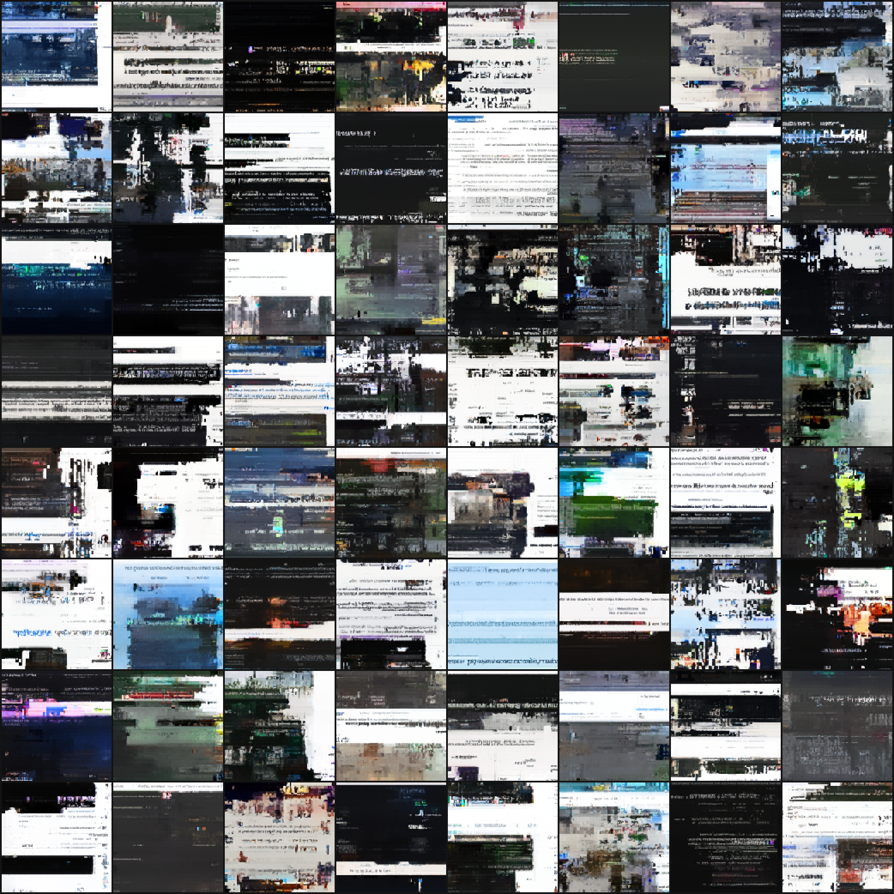

Continued from v2, but at **128×128** (4× the pixels): v2's 16×16 position map was stretched to 32×32 so its weights carry over. Two training-recipe changes:
- `--t_shift 0.5`: more practice on nearly-clean images, where fine detail is learned
- `--color_boost 2`: colorful and detailed crops are picked up to ~2.3× more often

Data: 45,050 crops at 128×128 (kept in RAM; only batches go to the GPU). Batch 32 (batch 64 needed 10 GB and overflowed the 8 GB card), lr 1e-4, 20 min, 4,602 steps, 123 images/sec, 5.4 GB VRAM. Loss 0.055 → **0.048**.

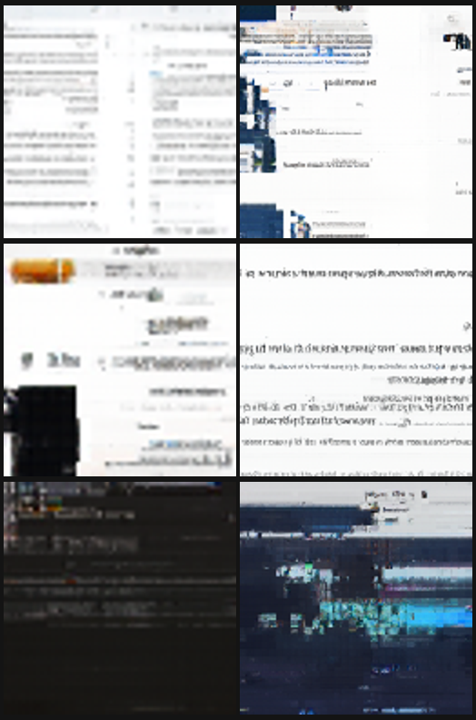

*Left: v2 (64×64, upscaled). Right: v3 (128×128). Same seeds.*

- ✅ **Less blurry:** text lines are crisp and word-shaped instead of a soft smear.
- ✅ **More color:** cyan, blue, orange, yellow and green accents show up far more often.
- ⚠️ **Messier layouts:** more collage-like compositions and noise in dark areas. 22M parameters now fill 4× the pixels with only 20 minutes of practice at this size.

**Copy check (v3):** nearest-real distances 22–86 (higher than v2's), and every sample clearly differs from its nearest training crop.

## Usage (on the GPU PC, from `Comet-Image/`)

```
python prep_images.py --src <screenshot folders> --out <private>/screens64.npy
python train_image.py --data <private>/screens64.npy --out <private>/runs --name Comet-Image-Preview-2026-11-08 --minutes 20
python generate.py <private>/runs/<run>/ema.pt --out <folder> --n 1 --seed 7 --smooth
```

## Next ideas

- Longer training and/or 128×128 resolution (needs about 4× compute)
- Patch size 2 for finer detail (4× more tokens, slower)
- Muon instead of AdamW, as in the language models
