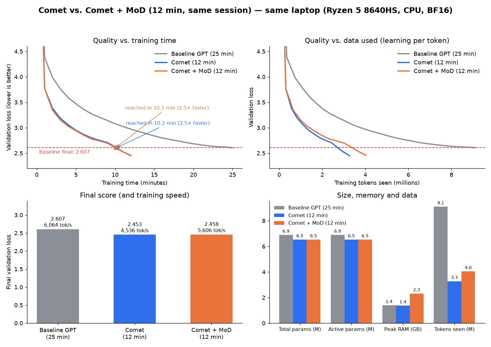

# Mixture of Depths (MoD)

## What was built (`comet/model.py`, `MoDRouter`; `comet/attention.py`)

- In selected layers, a tiny router (one linear layer) scores every token. **Tokens scoring > 0 go through the block; the rest skip it** and keep their value.
- **Causal routing:** each token decides from its own state only. The common "top 50% of the sequence" rule peeks at future tokens, which would make validation scores look better than they are. Instead, a side loss (BCE, weight 0.1) teaches the router to *predict* the top-50% pattern, and that keeps about 50% of tokens processed.
- **Verified:** changing a future token leaves earlier predictions exactly unchanged (max difference 0.0).
- Processed tokens run as a smaller sequence with their **original positions** (RoPE) and a causal mask, padded per batch. The block's update is scaled by sigmoid(score), which trains the router.

Turn on with `--set mod=true mod_every=2` (MoD on layers 1, 3, 5).

## 3-minute A/B (same session as the dense control)

| Model | Val loss | Next-token acc | Tokens/sec | Tokens processed in MoD layers |
|---|---|---|---|---|
| Dense Comet (control) | 3.115 | 39.1% | 4,641 | — |
| **MoD, every 2nd layer** | **3.106** | 39.0% | **5,037 (+9%)** | ~50% |
| MoD, every layer | 3.293 | 36.5% | 5,490 (+18%) | ~53% |

## Verdict

- **MoD on every other layer: a tie on quality (−0.009, within noise), 9% faster.** It's the first feature since Phase 3 that doesn't lose to dense Comet, and it does less work per token.
- **MoD on every layer loses clearly:** skipping in all layers throws away too much, more than the 18% speed-up buys back.
- The router held the 50% target well (49–54%) throughout training.

## 12-minute race (dense and MoD back to back, same session)

| Model | Final val loss | Next-token acc | Tokens/sec | Tokens seen | Reached 2.607 at | Peak RAM |
|---|---|---|---|---|---|---|
| Dense Comet | **2.453** | **47.3%** | 4,536 | 3.3M | 10.2 min | 1.4 GB |
| Comet + MoD (every 2nd layer) | 2.458 | 47.0% | **5,606 (+24%)** | 4.0M | **10.1 min** | 2.3 GB |

- **A tie at the finish (+0.005, within noise).** MoD led for most of the race (by up to 0.036 at minute 2–3), then dense caught up during the final learning-rate cooldown.
- MoD trains **24% faster** in tokens/sec, but each token teaches it a bit less, because half the tokens skip 3 of the 6 layers. The two effects cancel at 12 minutes.
- **MoD uses more memory** (2.3 GB vs 1.4 GB) for the subset buffers and masks.
- For reference, the original Comet v1 12-minute run (2.420) was made in a faster session, which is why same-session races matter.

**Decision:** MoD stays an option (`--set mod=true`), not a default. It's a clear win early in training (good for very short runs, around 2–7 minutes) but not at 12 minutes.

## Why the gain is small

At context 256 with d=256, attention is cheap, and the routing overhead (gather, scatter, padding, masks) eats part of the saving. MoD's gain should grow with longer contexts and wider models, where skipped work is a bigger share.

## Memory fix (2026-11-08)

**Cause:** not the masks or buffers. A memory profile showed MoD allocates *less* per step than dense. The real cause: the number of processed tokens changes every step, so every MoD tensor has a new size, and the CPU heap fragments. Peak RAM crept up step after step (1.2 → 1.8 GB in 30 steps, 2.1 GB by 100, 2.3 GB over 12 minutes). Dense stays flat.

**Fix:** `mod_bucket=64` (now the default) rounds the processed-token count up to a multiple of 64. Only a few fixed shapes exist, so the heap stops fragmenting. The extra slots are masked padding, so the math is unchanged.

Clean memory test (`tools/membench.py --steps 100`, random tokens, fresh process each):

| Setup | Peak RAM (above idle) | MB per M params | Tokens/sec |
|---|---|---|---|
| Dense Comet | 1,170 MB | 179 | 4,338 |
| MoD, exact sizes (old) | 2,101 MB | 322 | 5,222 |
| **MoD, bucket 64 (new)** | **1,202 MB (+3%)** | **184** | **5,897 (+36%)** |

The fragmentation was also slowing MoD down; with the fix it's faster than before.

3-minute A/B on real data, same session (`ab3s2_*`):

| Run | Val loss | Accuracy | Tokens/sec | Peak RAM |
|---|---|---|---|---|
| Dense Comet | 3.124 | 38.8% | 4,563 | 1,377 MB |
| **Comet + MoD (bucket 64)** | **3.114** | **39.0%** | **4,970 (+9%)** | 1,391 MB (+1%) |

**Result:** MoD no longer works against Goal 2. It now matches dense on RAM, stays slightly ahead on loss at 3 minutes, and is faster. In this real-data run the speed gain was +9%; the clean benchmark showed +36%. Real data plus eval pauses narrow the gap, and the laptop's heat varies, so the true gain is somewhere in between. Next: a 12-minute race to see whether the lead now holds to the finish.

### 12-minute race after the fix (same session, `race12s2_*`)

| Model | Final val loss | Accuracy | Tokens/sec | Tokens seen | Reached 2.607 at | Peak RAM |
|---|---|---|---|---|---|---|
| **Dense Comet** | **2.441** | **47.3%** | 4,658 | 3.35M | **9.8 min (2.55×)** | 1.40 GB |
| Comet + MoD (bucket 64) | 2.475 | 47.0% | 5,169 (+11%) | 3.72M | 10.3 min | 1.49 GB |
| *Earlier race: MoD, exact sizes* | *2.458* | *47.0%* | *5,606 (+24% vs its dense)* | *4.04M* | *10.1 min* | *2.36 GB* |

- **RAM is fixed for real:** 1.49 GB vs 2.36 GB before, within 6% of dense over a full 12-minute run.
- **But dense wins the race by 0.034.** MoD led only until minute 3; from minute 4 on it trailed by ~0.05 and never caught up.
- **The bucket costs speed in real training:** padding up to the next multiple of 64 means MoD layers process more tokens than they select. Its speed-up fell from +24% to +11%, which is no longer enough to make up for each token learning less.
- The clean benchmark (`membench`) showed bucketed MoD as *faster*, because its random-token routing and lack of eval pauses differ from real training. Lesson: confirm speed claims on real 12-minute runs.

**Decision:** keep the RAM fix, keep MoD **off by default**. MoD is not a lever toward the 5× goal at this model size. Possible later retry: bucket 16 or 32 (less padding, still few shapes) at longer contexts, where skipped attention work is worth more.

### Bucket 16 (12 minutes, `race12s2_mod_b16`, same session as `race12s2_dense`, ~1 hour later)

| Model | Final val loss | Accuracy | Tokens/sec | Tokens seen | Reached 2.607 at | Peak RAM |
|---|---|---|---|---|---|---|
| **Dense Comet** | **2.441** | **47.3%** | 4,658 | 3.35M | **9.8 min** | 1.40 GB |
| MoD, bucket 64 | 2.475 | 47.0% | 5,169 (+11%) | 3.72M | 10.3 min | 1.49 GB |
| MoD, bucket 16 | 2.473 | 46.9% | 5,399 (+16%) | 3.89M | 10.3 min | 1.49 GB |

- Less padding raised MoD's speed-up from +11% to +16%, and RAM stayed flat (1.49 GB, no creep over 12 minutes).
- **The loss barely moved (2.473 vs 2.475), and dense still wins by 0.03.** So padding wasn't what held MoD back. The limit is that skipped tokens learn less, and +16% more tokens doesn't make up for it at this model size.

**Final decision for now:** MoD stays off by default. The default is now `mod_bucket=16`, the fastest setting that still keeps RAM flat, for anyone who turns MoD on. Don't spend more time on MoD at context 256 / 6.5M parameters; revisit only for longer contexts or bigger models.
