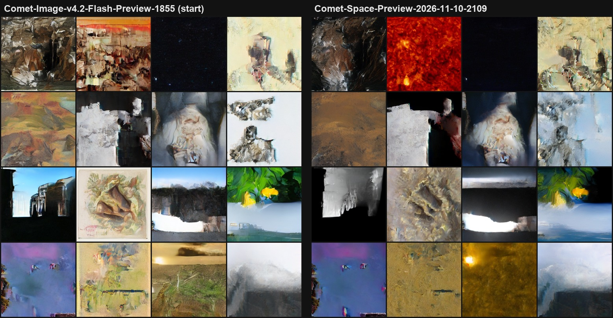
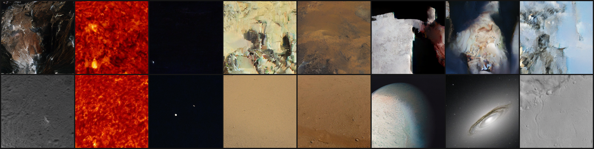

# Comet-Space

*Part of the [Comet hub](../README.md).*

**Comet-Space is the space-only image model of the Comet family:** the Sun, Mars, planets, the Moon, galaxies and nebulae. It is a 32.6M latent Diffusion Transformer (flow matching on Stable Diffusion VAE latents, 256×256, 30 sampling steps), fine-tuned from the general [Comet-Image](../Comet-Image/) model on space images only. The code is shared with Comet-Image (`../Comet-Image/`).

| Model | Status |
|---|---|
| **Comet-Space-Preview-2026-11-10-2109** | **First preview.** Comet-Image-v4.2-Flash-Preview-2026-11-10-1855 + 30 min on 22,048 space images |

## Comet-Space-Preview-2026-11-10-2109



*Same seeds, before (general model 1855) and after 30 minutes of space-only training. Sun surfaces (SDO 304 Å red plasma, 171 Å gold with a flare), Mars plains seen from orbit and cratered terrain appear where the general model drew landscapes and abstract shapes.*

**Data: 22,548 space images** (500 held out, never trained on; the other 22,048 give 44,082 latents: a center view plus one random crop each):

| Source | Images | How |
|---|---|---|
| NASA Image and Video Library | 15,871 | `fetch_nasa.py` (original + `--more` + Mars searches: Sun, planets, Moon, galaxies, nebulae, Jezero and Gale craters...), CLIP-filtered with `filter_space.py` (people, labs and diagrams removed) |
| The Sun: SDO via Helioviewer | 5,986 | `fetch_space.py --source sun`: random dates 2010–2025, 10 wavelengths (AIA EUV/UV, HMI visible), 30% full disk and 70% close-ups |
| Mars rover raw images | 691 | `fetch_space.py --source mars2020/msl`: Perseverance Mastcam-Z and Curiosity Mastcam/MAHLI color frames |

**Training:** from Comet-Image-v4.2-Flash-Preview-2026-11-10-1855, 30 minutes on the RTX 4060 Ti (10,446 steps, batch 64, lr 2e-4, `--t_shift 0.5`), about 15 passes over the data.

**Results:**

| | Start | 10 min | 20 min | 30 min |
|---|---|---|---|---|
| Eval on training images | 0.6516 | 0.6441 | 0.6415 | **0.6395** |
| Eval on **held-out** images (never trained on) | 0.6407 | 0.6335 | 0.6308 | **0.6298** |

The held-out loss falls almost as much as the training loss (−0.0109 vs −0.0121), so the model is learning space imagery in general rather than memorizing these images. The gap opened by only 0.0012 over 15 passes; more space data will be needed before much longer runs.

**Copy check** (`copy_check_latent.py`): generated images sit a median 47.7 from their nearest training image (minimum 34.5), vs 48.6 between different training images. New images, not copies; for example, a generated Sun close-up shares the style of its nearest SDO image but not its pattern.



Weights: [GitHub Release](https://github.com/TerminalDev-1/Comet/releases/tag/comet-space-preview-2026-11-10-2109).

```bash
cd ../Comet-Image
python generate_flash.py Comet-Space-Preview-2026-11-10-2109.safetensors --out images --n 4 --seed 7     # 30 steps
```

**Credits:** NASA (NASA Image and Video Library), NASA/SDO and the AIA and HMI science teams via [Helioviewer.org](https://helioviewer.org), NASA/JPL-Caltech/ASU (Perseverance), NASA/JPL-Caltech/MSSS (Curiosity). Released under the [Comet license](../LICENSE.md).

**Next:** more space data (the Mars raw-image API rate-limited this first download), de-duplicate repeated NASA images, then train further.
