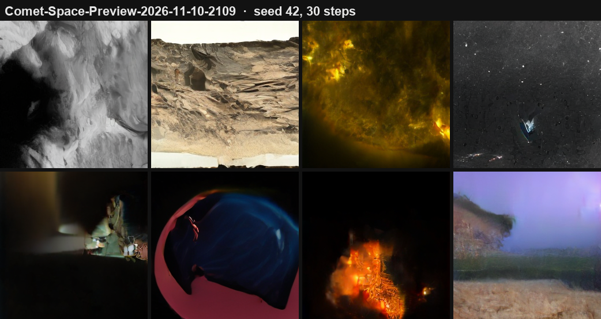

# Comet-Space

*Part of the [Comet hub](../README.md).*

**Comet-Space is the space-only image model of the Comet family:** the Sun, Mars, planets, the Moon, galaxies and nebulae. It is a 32.6M latent Diffusion Transformer (flow matching on Stable Diffusion VAE latents, 256×256, 30 sampling steps), fine-tuned from the general [Comet-Image](../Comet-Image/) model on space images only. The code is shared with Comet-Image (`../Comet-Image/`).

| Model | Status |
|---|---|
| **Comet-Space-Preview-2026-11-10-2109** | **First preview.** Comet-Image-v4.2-Flash-Preview-2026-11-10-1855 + 30 min on 22,048 space images |

## Development status: Comet-Space (Preview)

| | |
|---|---|
| **Status** | First preview. Latest checkpoint: **Comet-Space-Preview-2026-11-10-2109** |
| **Training time on Comet-Space** | **30 min** of space-only training (2026-11-10), on top of Comet-Image-v4.2-Flash-Preview-1855 (4 h 15 min of general training before it) |
| **Checkpoints released** | 1: 2109 |
| **Data** | 22,548 space images: 15,871 NASA library (CLIP-filtered), 5,986 SDO Sun images, 691 Mars rover photos. 43,905 de-duplicated training latents |
| **Latest eval** | Held-out space images: 0.6407 → **0.6298** (training images 0.6516 → 0.6395) |

**Why it isn't GA yet:**

1. **Only 30 minutes of training.** It already draws the Sun, Mars terrain and starfields, but it's the first pass.
2. **The dataset is small for long runs.** 30 minutes was ~15 passes over the data and the held-out gap is just starting to open (by 0.0012). More space images are needed before training much longer.
3. **Mars is under-represented.** The rover raw-image API rate-limited the download at 691 photos; planets other than Mars, the Moon and deep-sky images need more coverage too.

**GA when:** a bigger space dataset (more Mars, planets, Moon, galaxies), recognizable objects in most samples (a whole Sun disk, a planet, a nebula), and a held-out loss that has stopped improving. Then it ships as **Comet-Space** with a distilled 8-step Lite.

### Total time spent (development log)

Space-specific work on 2026-11-10, from run logs and commit times. The data work ran alongside the general model's (see [Comet-Image](../Comet-Image/README.md#total-time-spent-development-log)).

| Phase | Time | What happened |
|---|---|---|
| GPU training | **30 min** | Comet-Space-Preview-2109, from Comet-Image-1855 |
| Writing data tools, testing APIs | 14 min | `fetch_space.py` (Helioviewer Sun, Perseverance, Curiosity), extra NASA searches |
| Data download | 32 min | 5,986 Sun images, 13,422 NASA images (incl. ~2,500 Mars), 704 rover photos |
| Debugging | ~10 min | Rover API took 40–90 s per page, then rate-limited us (403); switched Mars to the NASA image library |
| Filtering, encoding, de-duplication | ~20 min | CLIP space filter, 22k images × 2 views, 177 duplicates removed |
| Evaluation and release | ~15 min | Copy check, sample grids, export, GitHub release, README |
| **Total** | **~2 h** | about 25% of it GPU training |

## Comet-Space-Preview-2026-11-10-2109



*Seed 42, 30 steps: a golden Sun with flares at the limb, a layered Mars rock outcrop, cratered gray terrain, a starfield and glowing orange plasma.*


*Same seeds, before (general model 1855) and after 30 minutes of space-only training. Sun surfaces (SDO 304 Å red plasma, 171 Å gold with a flare), Mars plains seen from orbit and cratered terrain appear where the general model drew landscapes and abstract shapes.*

**Data: 22,548 space images** (500 held out, never trained on; the other 22,048 give 44,082 latents: a center view plus one random crop each):

| Source | Images | How |
|---|---|---|
| NASA Image and Video Library | 15,871 | `fetch_nasa.py` (original + `--more` + Mars searches: Sun, planets, Moon, galaxies, nebulae, Jezero and Gale craters...), CLIP-filtered with `filter_space.py` (people, labs and diagrams removed) |
| The Sun: SDO via Helioviewer | 5,986 | `fetch_space.py --source sun`: random dates 2010–2025, 10 wavelengths (AIA EUV/UV, HMI visible), 30% full disk and 70% close-ups |
| Mars rover raw images | 691 | `fetch_space.py --source mars2020/msl`: Perseverance Mastcam-Z and Curiosity Mastcam/MAHLI color frames |

**Training:** from Comet-Image-v4.2-Flash-Preview-2026-11-10-1855, 30 minutes on the RTX 4060 Ti (10,446 steps, batch 64, lr 2e-4, `--t_shift 0.5`), about 15 passes over the data.

**Results:**

| | Start | 10 min | 20 min | 30 min |
|---|---|---|---|---|
| Eval on training images | 0.6516 | 0.6441 | 0.6415 | **0.6395** |
| Eval on **held-out** images (never trained on) | 0.6407 | 0.6335 | 0.6308 | **0.6298** |

The held-out loss falls almost as much as the training loss (−0.0109 vs −0.0121), so the model is learning space imagery in general rather than memorizing these images. The gap opened by only 0.0012 over 15 passes; more space data will be needed before much longer runs.

**Copy check** (`copy_check_latent.py`): generated images sit a median 47.7 from their nearest training image (minimum 34.5), vs 48.6 between different training images. New images, not copies; for example, a generated Sun close-up shares the style of its nearest SDO image but not its pattern.


Weights: [GitHub Release](https://github.com/TerminalDev-1/Comet/releases/tag/comet-space-preview-2026-11-10-2109).

```bash
cd ../Comet-Image
python generate_flash.py Comet-Space-Preview-2026-11-10-2109.safetensors --out images --n 4 --seed 7     # 30 steps
```

**Credits:** NASA (NASA Image and Video Library), NASA/SDO and the AIA and HMI science teams via [Helioviewer.org](https://helioviewer.org), NASA/JPL-Caltech/ASU (Perseverance), NASA/JPL-Caltech/MSSS (Curiosity). Released under the [Comet license](../LICENSE.md).

**De-duplicated afterwards** with `dedup_latents.py`: 173 duplicate latents (NASA images listed under two IDs) and 4 training latents that matched held-out images (under 1% of the 500, so the held-out numbers above barely change). Future runs use `space_latents_dedup.npy` (43,905 latents).

**Next:** more space data (the Mars raw-image API rate-limited this first download), then train further.
