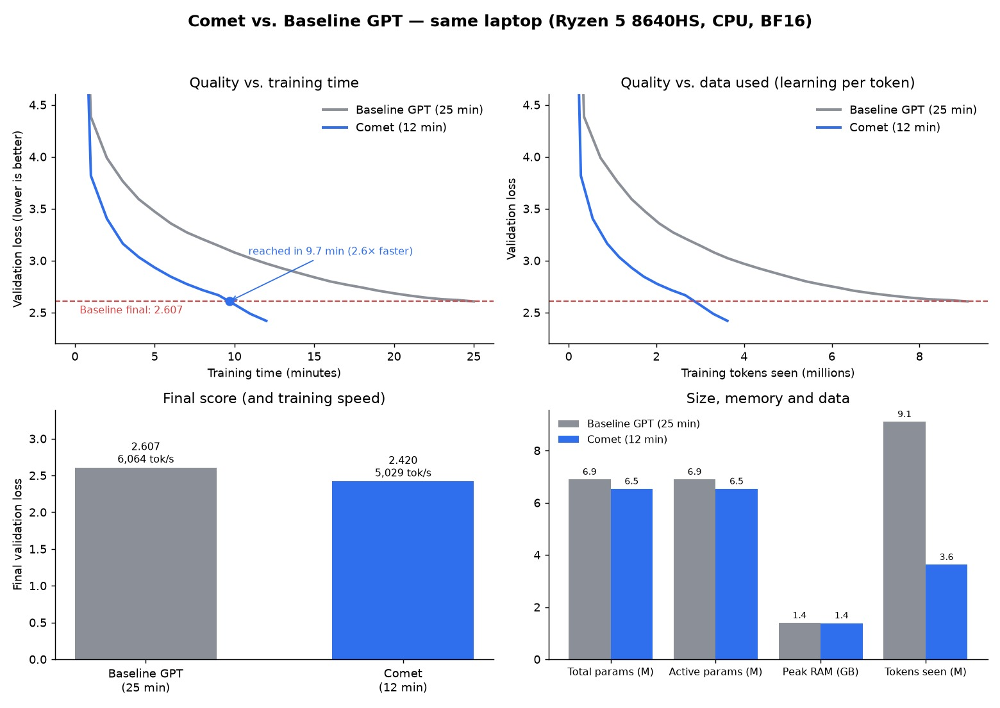
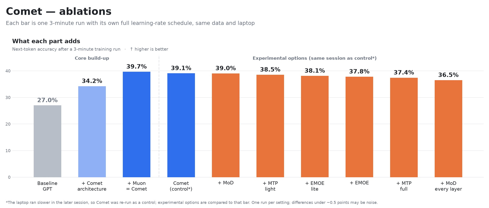

# Comet

A faster-to-train Transformer variant, built and benchmarked on a laptop CPU (AMD Ryzen 5 8640HS, no GPU).



## Results

| Model | Train time | Final val loss | Next-token accuracy | Time to reach 2.607 |
|---|---|---|---|---|
| Baseline GPT | 25 min | 2.607 | 45.2% | 25.0 min |
| **Comet** (same-session run) | **12 min** | **2.453** | **47.3%** | **10.2 min (2.5×)** |
| Comet (best run) | 12 min | 2.420 | 47.6% | 9.7 min (2.6×) |

Same data (TinyStories), same tokenizer, same size (~6.5–6.9M parameters), same laptop.
Full numbers: [results/benchmark.md](results/benchmark.md) · details: [results/phase3.md](results/phase3.md) · loss curves: [results/curves.jpg](results/curves.jpg).



**What makes Comet original:** Comet is its own efficiency-focused Transformer architecture. Its specific design (attention setup, optimizer split, schedule, and the norm and attention kernels chosen by measuring on a laptop CPU) trains **2.5× faster than a standard GPT on the same hardware**. Like Llama, it builds on published components, credited here: RoPE (Su et al.), QK-Norm (Dehghani et al.), GQA (Ainslie et al.), SwiGLU (Shazeer), the Muon optimizer (Jordan et al.) and the WSD schedule (MiniCPM). Comet's own additions, EMOE (Efficient Mixture of Experts) and causal Mixture of Depths, are built and tested below; see [NEXT.md](NEXT.md) for the plan to make them win.

## What's in Comet so far

- **Attention:** rotary positions (RoPE), QK-Norm, grouped-query attention
- **MLP:** SwiGLU
- **Training:** Muon optimizer (hidden matrices) + AdamW (embeddings), warmup-stable-decay schedule, BF16
- **CPU-tuned:** plain attention math and LayerNorm, which measured faster than the "fused" kernel and RMSNorm on this CPU

## Experimental options (built and tested, off by default)

| Option | Turn on | 3-min result vs dense Comet | Notes |
|---|---|---|---|
| **EMOE** (Efficient Mixture of Experts) | `--set emoe=true` | 3.20 vs 3.115 | 2.6× the parameters at the same compute; 91% of dense speed. [results/emoe.md](results/emoe.md) |
| **Multi-token prediction** | `--set mtp_depth=1` | 3.17 vs 3.115 | Light version shown. [results/mtp.md](results/mtp.md) |
| **Mixture of Depths** | `--set mod=true` | 3.106 vs 3.115 | 12-min race: tie (2.458 vs 2.453), +24% tokens/sec. [results/mod.md](results/mod.md) |

Coming next (see [plan.md](plan.md)): parameter reuse (looped blocks), adaptive loop depth, reusable package, research paper.

## Run it

```bash
python -m venv .venv
.venv/Scripts/pip install torch --index-url https://download.pytorch.org/whl/cpu
.venv/Scripts/pip install -r requirements.txt
.venv/Scripts/python data/prepare.py          # download + filter TinyStories, train tokenizer (~4 min)
.venv/Scripts/python train.py --model comet --name my_run --minutes 12 --lr 0.003 --optim muon --schedule wsd
.venv/Scripts/python sample.py checkpoints/my_run.pt
.venv/Scripts/python bench.py --runs baseline_d256_l6 my_run
```

## License

Comet is by **Talmeez Ahmad**, made with Claude (Anthropic). You can use and fork it freely, but you must credit Talmeez Ahmad and include the attribution notice in your README. See [LICENSE.md](LICENSE.md).
