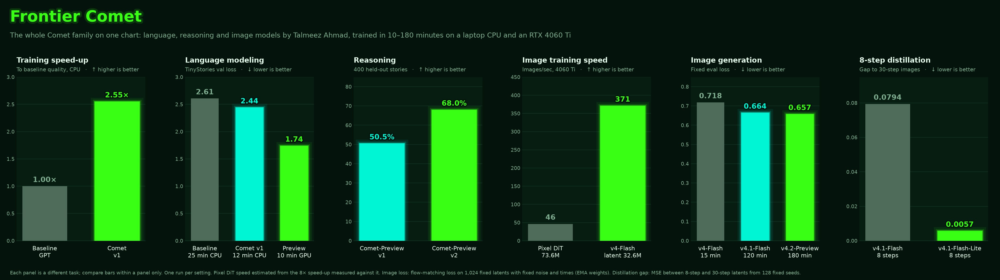
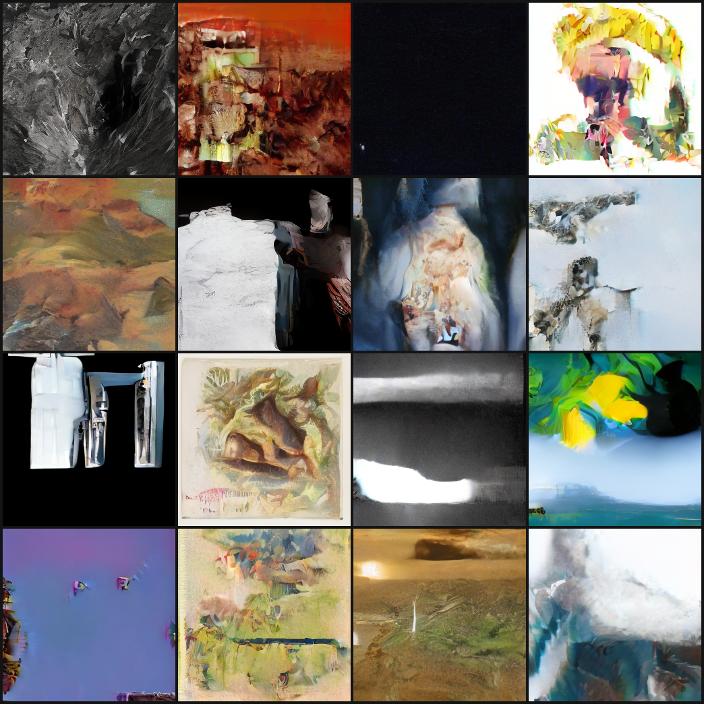

# Comet

**Comet is a family of models by Talmeez Ahmad, made with Claude (Anthropic).** This repo is the hub: every Comet model lives in its own folder here, and they all share the same training setup (a home GPU driven from a laptop over SSH).

*Frontier Comet: the whole family on one launch-style chart. Each panel is its own task. Made by [benchmarks/frontier_comet.py](benchmarks/frontier_comet.py).*

*Above: Comet-Image-v4.1-Flash (GA), 256×256 images in 30 steps, after 2 hours of training on a home GPU (public data only).*

## The family

| Model | Folder | What it is | Best result |
|---|---|---|---|
| **Comet v1** (sunset) | [Comet-LM/](Comet-LM/) | Efficient Transformer trained on a laptop CPU | Baseline GPT quality **2.55× faster** (9.8 vs 25 min) |
| **Comet-Preview** | [Comet-LM/](Comet-LM/) | 15.7M language model that **thinks in English** in `<think>` tags | **68%** on held-out story reasoning (v2), 13 min of GPU training |
| **Comet-Image-v4.1-Flash** (GA) | [Comet-Image/](Comet-Image/) | 32.6M **latent** Diffusion Transformer on public general + NASA space images; 2 h of training | **256×256** images in **30 steps**, eval loss 0.718 → **0.664**. [Weights](https://github.com/TerminalDev-1/Comet/releases/tag/comet-image-v4.1-flash) |
| **Comet-Image-v4.1-Flash-Lite** (GA) | [Comet-Image/](Comet-Image/) | v4.1-Flash distilled to **8 steps** | Nearly the same images ~4× faster (8-vs-30-step gap 0.0794 → 0.0057). [Weights](https://github.com/TerminalDev-1/Comet/releases/tag/comet-image-v4.1-flash-lite) |
| **Comet-Image-v4.2-Flash-Preview-2026-11-09-2032** | [Comet-Image/](Comet-Image/) | v4.1-Flash + 60 min (3 h total) | Eval loss **0.6574** (v4.1: 0.6644); images close to v4.1. [Weights](https://github.com/TerminalDev-1/Comet/releases/tag/comet-image-v4.2-flash-preview-2026-11-09-2032) |
| Comet-Image-v4-Flash-Preview | [Comet-Image/](Comet-Image/) | Preview checkpoints (2026-11-08 → 2026-11-09-1641, Distill-1711), superseded by v4.1 | |
| Comet-Image-Preview v1, v2, v3 | [Comet-Image/](Comet-Image/) | 🗄️ Legacy, discontinued (screenshot-only) | |

Write-ups: [Comet-LM/README.md](Comet-LM/README.md) (v1), [Comet-LM/results/comet_preview.md](Comet-LM/results/comet_preview.md), [Comet-Image/README.md](Comet-Image/README.md).

## How the hub works

- **One folder per model line.** New Comet models (a classifier, a tiny specialist, a looped Transformer...) get their own folder: `Comet-<Name>/`.
- **Naming:** experimental models are `Comet-<Variant>-YYYY-MM-DD-HHMM`: the date and UK time (24h) the training run finished, e.g. `Comet-Image-v4-Flash-Preview-2026-11-09-1604`. Names from before 2026-11-09 have the date only, e.g. `Comet-Preview-2026-11-08`. **Preview** = the first training pass is released, then the model keeps training until it's right. Discontinued models are marked 🗄️ Legacy.
- **Training hardware:** an RTX 4060 Ti PC, controlled from the laptop over SSH, so nobody has to sit at it. Setup: [SSH_SETUP.md](SSH_SETUP.md) and [pc_setup.ps1](pc_setup.ps1).
- **One shared Python environment** at `Comet/.venv` (not in git).
- **Private data stays private:** anything made from personal files (screenshots, crops, weights trained on them) lives in a `private/` folder that git ignores.
- Ideas for future architectures: [research.md](research.md).

## License

Comet is by **Talmeez Ahmad**, made with Claude (Anthropic). You can use and fork it freely, but you must credit Talmeez Ahmad and include the attribution notice in your README. See [LICENSE.md](LICENSE.md).
