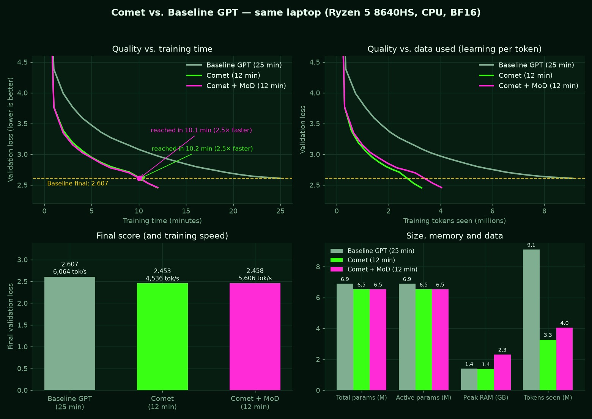

# Benchmark

| Model | Train time | Final val loss | Time to reach baseline's final loss | Tokens/sec | Tokens seen | Params (total / active) | Peak RAM |
|---|---|---|---|---|---|---|---|
| Baseline GPT (25 min) | 25 min | **2.607** | 25.0 min | 6,064 | 9.1M | 6.89M / 6.89M | 1,420 MB |
| Comet (12 min) | 12 min | **2.453** | 10.2 min | 4,536 | 3.3M | 6.52M / 6.52M | 1,397 MB |
| Comet + MoD (12 min) | 12 min | **2.458** | 10.1 min | 5,606 | 4.0M | 6.53M / 6.53M | 2,361 MB |
