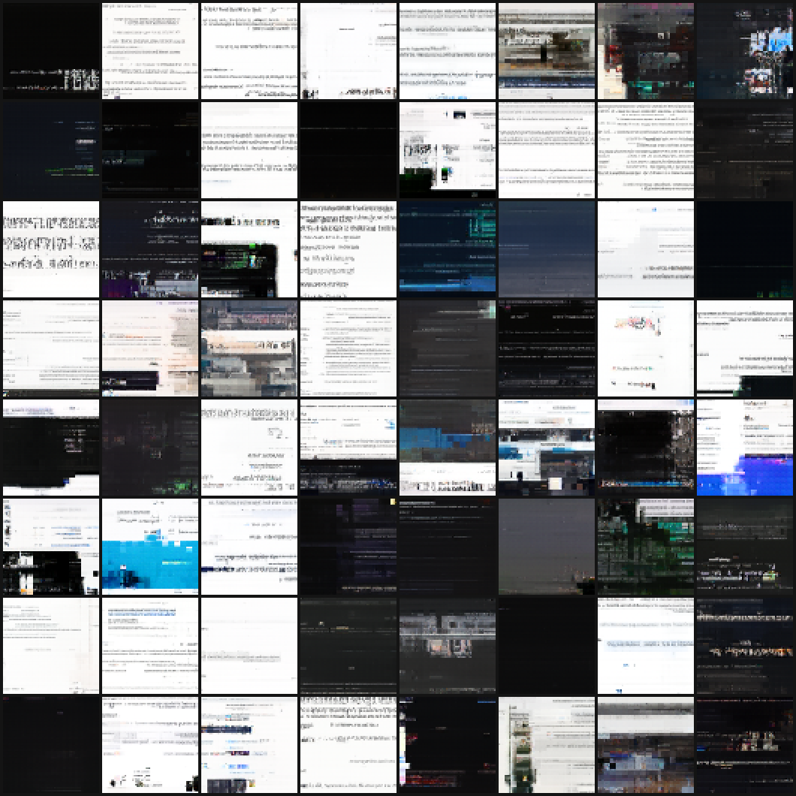

# Comet-Image-Preview-2026-11-08 (and v2)

*64 images generated from pure noise by **Comet-Image-Preview-v2-2026-11-08** (shown at 2× size). None of them is a real screenshot; see the copy check below.*

The first **image model** in the Comet family: a small **Diffusion Transformer (DiT)** trained with flow matching (the Stable Diffusion 3 recipe) on Talmeez's own screenshots, on the RTX 4060 Ti over SSH.

*The screenshots, the training crops, the copy-check images and the weights are private: they stay out of this repo (in `private/` locally, `~/comet_private` on the PC).*

## Setup

| | |
|---|---|
| Data | 2,647 screenshots (laptop + PC) → **87,186 random square crops** at 64×64 (`comet_image/prep_images.py`), mirrored at random during training |
| Model | DiT, 22.0M params: 4×4 patches (256 tokens), d=384, 8 layers, 6 heads, adaLN-Zero time conditioning (`comet_image/dit.py`) |
| Training | 20 min, batch 128, AdamW 3e-4 with warmup and cooldown, bf16, EMA 0.999. 5,532 steps, ~590 images/sec, 6.4 GB VRAM (`comet_image/train_image.py`) |
| Sampling | 60 Euler steps from pure noise |
| Loss | 0.90 (min 1) → 0.11 (min 2) → 0.061 (min 10) → **0.053** (min 20) |

## What it makes

Small images that clearly *look like screenshots*, without being any particular one:
- **Document and web pages:** white backgrounds, a bolder heading line, rows of tiny "text" (fake squiggles, not readable), paragraph gaps, the odd blue link.
- **Dark-mode windows:** black or charcoal backgrounds with faint text rows and small colored accents (green, orange, blue).
- **App layouts:** horizontal bands, like a toolbar, then content, then a bottom bar; blue desktop-like backgrounds.
- **Weak spots:** busy or photo-like crops come out as blocky mosaics (the 4×4 patch grid shows). No readable text, which is expected at 64×64 and 20 minutes.

Progress across grids (min 4 → 8 → 12 → 16 → 20): static with the right colors → text rows and regions → headings and paragraphs → app-window bands → sharper, with smoother flat areas.

## Copy check

For 16 samples, the nearest of all 87k training crops (pixel distance) was found and compared side by side. The nearest real crops have readable UI text and sharp edges; the generated ones don't match any of them. Very small distances (10–12) only happen for near-blank tiles (all dark or all white). **The model makes new screenshot-like images; it isn't copying training images.**

## v2: 20 more minutes (Comet-Image-Preview-v2-2026-11-08)

Continued from v1's weights for another 20 minutes (lr 2e-4), with 8 new screenshots added (87,450 crops). Loss **0.053 → 0.046**. Compared with v1: crisper text pages (evenly spaced lines, indents, bold headings, blue link lines), smoother gradients (blue and gray backgrounds no longer blocky), and fewer chaotic mosaics. Busy photo-like crops are still the weak spot.

**Copy check (v2):** the closest matches (pixel distance 3–13) are all near-black tiles next to other near-black tiles (an empty dark screen next to an empty dark screen). Every tile with content differs clearly from its nearest real crop. It still makes new images rather than copying.

## Next ideas

- Longer training and/or 128×128 resolution (needs about 4× compute)
- Patch size 2 for finer detail (4× more tokens, slower)
- Muon instead of AdamW, as in the language models
