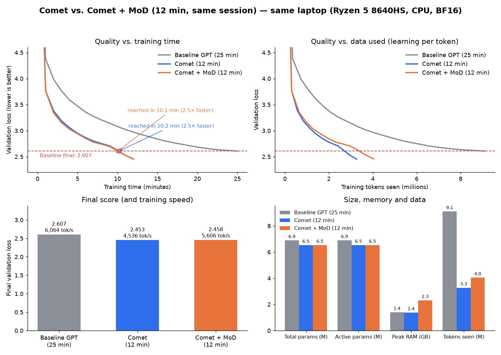

# Mixture of Depths (MoD)

## What was built (`comet/model.py`, `MoDRouter`; `comet/attention.py`)

- In selected layers, a tiny router (one linear layer) scores every token. **Tokens scoring > 0 go through the block; the rest skip it** and keep their value.
- **Causal routing:** each token decides from its own state only. The common "top 50% of the sequence" rule peeks at future tokens, which would make validation scores look better than they are. Instead, a side loss (BCE, weight 0.1) teaches the router to *predict* the top-50% pattern, and that keeps about 50% of tokens processed.
- **Verified:** changing a future token leaves earlier predictions exactly unchanged (max difference 0.0).
- Processed tokens run as a smaller sequence with their **original positions** (RoPE) and a causal mask, padded per batch. The block's update is scaled by sigmoid(score), which trains the router.

Turn on with `--set mod=true mod_every=2` (MoD on layers 1, 3, 5).

## 3-minute A/B (same session as the dense control)

| Model | Val loss | Next-token acc | Tokens/sec | Tokens processed in MoD layers |
|---|---|---|---|---|
| Dense Comet (control) | 3.115 | 39.1% | 4,641 | — |
| **MoD, every 2nd layer** | **3.106** | 39.0% | **5,037 (+9%)** | ~50% |
| MoD, every layer | 3.293 | 36.5% | 5,490 (+18%) | ~53% |

## Verdict

- **MoD on every other layer: a tie on quality (−0.009, within noise), 9% faster.** It's the first feature since Phase 3 that doesn't lose to dense Comet, and it does less work per token.
- **MoD on every layer loses clearly:** skipping in all layers throws away too much, more than the 18% speed-up buys back.
- The router held the 50% target well (49–54%) throughout training.

## 12-minute race (dense and MoD back to back, same session)

| Model | Final val loss | Next-token acc | Tokens/sec | Tokens seen | Reached 2.607 at | Peak RAM |
|---|---|---|---|---|---|---|
| Dense Comet | **2.453** | **47.3%** | 4,536 | 3.3M | 10.2 min | 1.4 GB |
| Comet + MoD (every 2nd layer) | 2.458 | 47.0% | **5,606 (+24%)** | 4.0M | **10.1 min** | 2.3 GB |

- **A tie at the finish (+0.005, within noise).** MoD led for most of the race (by up to 0.036 at minute 2–3), then dense caught up during the final learning-rate cooldown.
- MoD trains **24% faster** in tokens/sec, but each token teaches it a bit less, because half the tokens skip 3 of the 6 layers. The two effects cancel at 12 minutes.
- **MoD uses more memory** (2.3 GB vs 1.4 GB) for the subset buffers and masks.
- For reference, the original Comet v1 12-minute run (2.420) was made in a faster session, which is why same-session races matter.

**Decision:** MoD stays an option (`--set mod=true`), not a default. It's a clear win early in training (good for very short runs, around 2–7 minutes) but not at 12 minutes.

## Why the gain is small

At context 256 with d=256, attention is cheap, and the routing overhead (gather, scatter, padding, masks) eats part of the saving. MoD's gain should grow with longer contexts and wider models, where skipped work is a bigger share.
